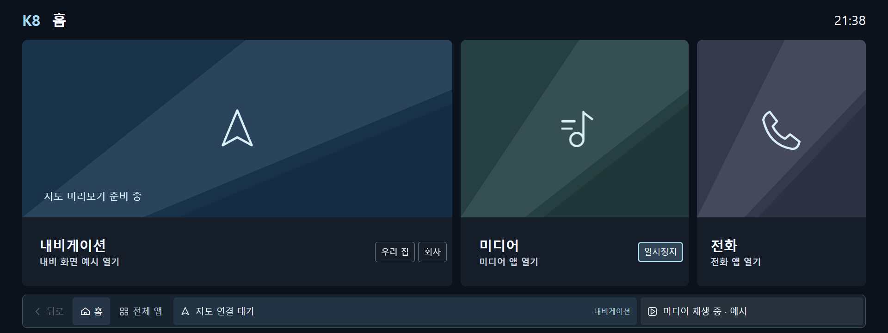
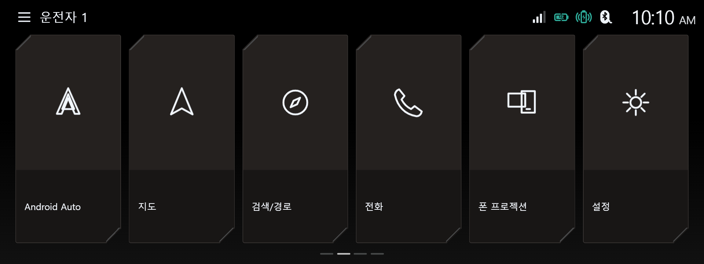
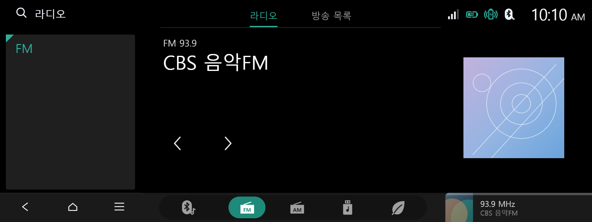
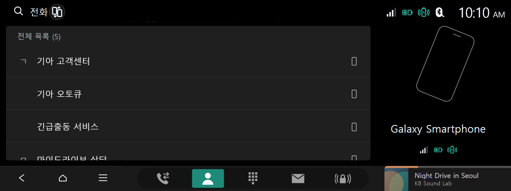

# K8 ccNC 홈 테마 (k8-ccnc-home-theme)

기아 K8 Gen5W(1920×720, Android 4.4 / API 19)에서 사용할 수 있도록 기아 ccNC 공식 매뉴얼의 화면을 구현하는 프로젝트입니다.

## ⬇️ 내려받기 (0.5.0-test68, 2026-11-27)

| 파일 | 용도 |
|---|---|
| [**최신 배포용 내려받기 (Releases · Latest)**](https://github.com/dlatnqls0815-spec/k8-ccnc-home-theme/releases/latest) | 항상 최신 ✅ 배포용으로 연결되는 주소. **이 주소를 공유하세요.** 🧪 테스터용(Pre-release)은 받지 마세요 |
| [**K8-ccNC-Home-NEMESIS-0.5.0-test68-USB.zip**](downloads/K8-ccNC-Home-NEMESIS-0.5.0-test68-USB.zip?raw=1) | NEMESIS 설치 묶음(테마 앱 + 곡 넘기기·AA 실행·진단 로그 도우미). USB 로 설치. 테마 앱만 필요하면 안의 `packages/…zip` 속 `app/k8-home.apk` |
| [**k8home-0.5.0-test68.apk**](https://github.com/dlatnqls0815-spec/k8-ccnc-home-theme/releases/download/v0.5.0-test68/k8home-0.5.0-test68.apk) | 테마 앱 단독 APK (도우미 없이 앱만 설치) |

**설치(USB)**: zip 을 풀어 안의 `NEMESIS.data` 와 `packages` 폴더를 USB 최상위에 둔다(기존 `NEMESIS.data` 가 있으면 백업) → 정차 상태에서 NEMESIS 매니저 **Package Store → USB → K8 ccNC Home Theme** 설치 → **My Packages → K8 ccNC Home Theme → Launch**. 자세한 것은 [네메시스 설치 안내](docs/NEMESIS_INSTALL.md).

**test65 이후 바뀐 것 (test68, 2026-11-26~27 K8 실차 확인)**
- **시트·공조 팝업 추가**: 테마 화면 하단 가운데 또는 순정 내비 하단바(미디어 칸 밖)에서 위로 쓸어 열기 — K8 실차 공조(운전석·조수석 온도, 바람 세기, AUTO 3단계, A/C, SYNC, 풍향 순환, 내외기, 앞유리 성에, 공기청정, OFF) + 앞·뒷좌석 열선/통풍·핸들 열선 제어(차량 옵션 없는 버튼 자동 숨김)
- **순정 내비 위 ccNC 하단바 완성**:
  - 차량 순정 시스템 글꼴(`Mobis-Regular`)로 거리 숫자·소요시간/도착시각·목적지 글꼴·굵기·크기·세로 중심 완전 통일, 위쪽 6px 빈 줄 제거
  - 남은 시간·도착 시각 5초 교대 시 구분선·깃발·목적지 흔들림 방지, 0~9분 구간 시간 사라짐 버그 수정, 정차 중 남은 시간 재조회
  - 순정 내비 지도 터치(좌표 찍기) 시 하단바 자동 숨김(18초 후 복귀), 하단바·홈 복귀 시 앨범 표지 누락 수정
- **실차 랙 원인 규명 및 대폭 개선 (ADB·CDP 실측)**:
  - 숨은 캔버스 1.5배 반복 증식(곡 넘김 2.4초 멈춤) 해결, 커버 JPEG 384px 축소, 재생 위치만 바뀔 때 홈 전체 재렌더 생략, 홈 이탈 5초 뒤 숨은 지도 `TextureView` 중지, 긴 글자 흐르기(`marquee`) 무한 반복·슬라이드 중 재계산 차단
  - 화면 클릭마다 앱서랍 4페이지 캐시 파괴 + 디스크 동기 저장(`commit`) 제거, 자연의 소리 PNG 10장·라디오 로고 56장 지연/원본 PNG 워커 서빙 전환(`JavaBridge` CPU 2.02초 → 0.04초), 홈 복귀 시 `getprop` 18회 `fork` 제거·블루투스 조회 백그라운드 분리(실차 홈 `rAF` 평균 17.6ms ≈ 60fps)
- **홈·Android Auto**: 홈 왼쪽 위 운전자 이름 끝 잘림 재발 방지(20자 실차 확인), 재설치 직후 원형 버튼 축소 수정, Android Auto 오디오(`HKMC_GPM`) 미디어 정보 수신 추가

**이 판에서 되는 것**
- **기아 ccNC 검정·청록 통일 화면**: 홈·전체 앱(재배치·타일 숨기기)·미디어(`main2` 통일)·전화·설정(6×2 + `5W 설정` 카드)·ccNC 테마 설정 타일
- **순정 내비 위 ccNC 하단바 & 분할화면 손잡이**: 지도 오른쪽 끝 ccNC 세로 손잡이로 순정 분할화면 열기(열리면 하단바 자동 숨김), 하단 미니 플레이어 터치 시 내비 위로 재생 상세 시트(아래로 끌어 닫기·`≡`로 미디어 화면 이동)
- **미디어·라디오·자연의 소리·실시간 가사**: 블루투스·USB 실시간 싱크 가사(LRCLIB + NetEase, 앨범명 표시), 라디오 FM·AM 방송 목록·로고, 자연의 소리 바로 재생, 하단 소스 탭 순정 화면 없이 바로 전환 + 순정 오른쪽 팝업 닫기
- **전화 순정 연동**: 최근 통화·연락처(초성 머리글자 + 번호별 종류 아이콘)·키패드(자주 통화한 번호)·메시지(MAP 동기화·새로고침)·프라이버시 모드(직접 ON/OFF 토글 연동), 오른쪽 폰 칸에 신호·배터리·무선충전(WPC) 표시
- **편의 기능 & 기본값 바로 사용**: 설치 즉시 **시동 후 자동 실행 · 내비 위 ccNC 하단바 · 즐겨찾기(☆) 버튼(짧게 ccNC 테마 / 길게 순정 5W 홈) · 사운드 직접 변경 · 추천 앱 타일 구성(주요 13개 표시, 12개 기본 숨김 — 길게 눌러 재배치에서 언제든 변경 가능)**이 켜진 상태로 바로 사용할 수 있습니다.
- **기타**: 우리 집·회사 버튼 1초 꾹 눌러 등록·변경, Android Auto 타일 바로 실행, 블루투스 곡 넘기기(하단바 밀기·핸들 버튼)

**알려진 것**: 앱을 덮어 설치한 뒤 처음 홈 버튼을 누르면 "홈 앱 선택"이 뜰 수 있으며 `K8 홈 → 항상`을 선택하면 고정됩니다. 메시지는 블루투스 연결 후 새로 수신된 문자부터 표시됩니다.

**주의**: 개인이 만든 시험판입니다. 차량 순정 시스템 위에서 도는 NEMESIS 모듈이므로 본인 책임으로 설치하세요. 문제가 생기면 NEMESIS 매니저에서 지우면 순정으로 돌아갑니다.

만들기:

```bash
python build.py --sdk "<Android_SDK_경로>" --jdk "<JDK_경로>" --output "<출력_APK_경로>"
python tools/build_nemesis.py --home-apk "<출력_APK_경로>" --jdk "<JDK_경로>" --out "<USB_묶음_출력_경로>"
```

작업 기록: [차량용 인수인계](docs/AI_HANDOFF.md) · [실차 확인 목록](docs/설정-차시험.md)


## 🌐 바로 체험하기 (라이브 웹 데모 링크)

- [**최신 화면 체험 (GitHub Pages)**](https://dlatnqls0815-spec.github.io/k8-ccnc-home-theme/)
  - 스와이프, 카드 재배치, 한글 검색, 전화 키패드, 퀵 컨트롤을 체험할 수 있습니다. 지도·미디어·통화 기록에는 예시 데이터가 표시됩니다. 순정 기능 연결과 음성 메모 녹음은 차량용 APK에서 사용합니다.

## 📸 실제 구현 화면 (`0.5.0-test60`, 1920×720)

### 1. 홈 화면 (내비 경로 카드 · 블루투스 미디어 · 전화 · 상단 상태바)


### 2. 전체 앱 1페이지 (기본 6타일)


### 3. 전체 앱 2페이지 (ccNC 테마 설정 · 네메시스 · 확장 앱)


### 4. 블루투스 오디오 & 실시간 싱크 가사


### 5. FM 라디오 (주파수 · 방송국 이름 · 목록 전환)


### 6. 전화 키패드 & 휴대폰 상태 (신호 · 충전 배터리 · 무선충전 WPC)


### 7. 전화 연락처 (순정 블루투스 연락처 연동 · 초성 구분)


### 8. 설정 홈 (6×2 12카드 · `5W 설정` 포함)


### 9. ccNC 테마 설정 (화면구성 > 테마 설정)


## 🛠 Android APK 빌드 방법

```bash
python build.py --sdk "<Android_SDK_경로>" --jdk "<JDK_경로>" --output "<출력_APK_경로>"
```
