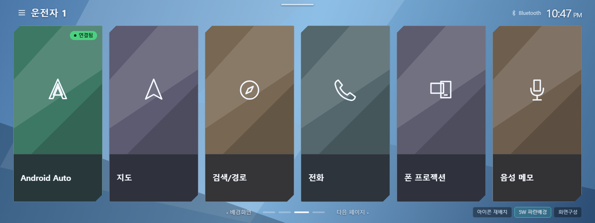
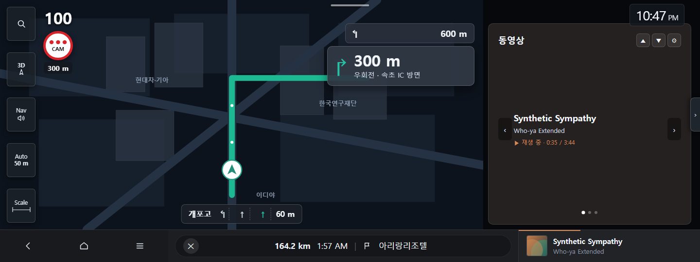

# K8 ccNC 홈 테마 (k8-ccnc-home-theme)

기아 K8 Gen5W(1920×720, Android 4.4 / API 19)에서 사용할 수 있도록 기아 ccNC 공식 매뉴얼의 화면을 구현하는 프로젝트입니다.

**차량용 Android 소스 0.4.6**에는 홈 카드, 전화 키패드, 한글 통합 검색, 밝기와 블루라이트 설정, 블루투스 등록 기기, 음성 메모가 포함됩니다. 구현된 동작과 실차 확인 항목은 [차량용 인수인계](docs/AI_HANDOFF.md)에 정리했습니다. APK는 아래 빌드 명령으로 생성할 수 있습니다.

## 🌐 바로 체험하기 (라이브 웹 데모 링크)

- **라이브 데모 (GitHub Pages)**: **https://dlatnqls0815-spec.github.io/k8-ccnc-home-theme/**
  - 데스크톱·모바일·태블릿에서 초기 웹 데모의 화면과 제스처를 체험할 수 있습니다. 아래 미리보기와 기능 목록은 이 데모를 기준으로 합니다.

## 📸 화면 미리보기

### 1. 홈 화면 (5W 파란 배경 + 지도·미디어·전화 3카드)


### 2. 전체 기능 앱 타일 (Android Auto 연결됨 배지 · 6개 챔퍼 타일 · 아이콘 재배치)


### 3. 내비게이션 & 오른쪽 분할 화면 위젯 (3D 지도 · TBT 안내 · 차선 안내 · 하단 경로바)


## ✨ 구현된 주요 화면 및 기능

1. **홈 화면 & 대기 화면 & 전체 기능 (1·2페이지)**
   - 상단 `≡ 운전자 1` 프로필 전환, 중앙 **퀵 컨트롤 핸들 바**(아래로 드래그/클릭 시 3열 퀵 컨트롤 오픈), 우측 12시간제(`AM`/`PM`) 시계
   - ccNC 시그니처 **45도 사선 커팅(Chamfered Corners)** 및 대각선 면 분할 그래픽, `5W 파란배경` ↔ `ccNC 다크배경` 전환
   - 좌우 스와이프 및 하단 4단 페이지 인디케이터로 **대기 화면(시계·날씨·미디어)** ↔ **홈(지도·미디어·전화)** ↔ **전체 앱 1페이지(6타일)** ↔ **전체 앱 2페이지(6타일)** 전환
   - 전체 앱 화면에서 **드래그 앤 드롭(또는 화살표) 아이콘 재배치** 지원
2. **내비게이션**
   - 좌측 5개 플로팅 컨트롤(`🔍`, `3D/2D/N`, `Nav 🔊`, `Auto 50 m`, `Scale`), 제한속도 `100` 및 단속카메라 알림, 우상단 2단 TBT 안내 카드, 하단 차선 안내 박스, 하단 경로 캡슐(`[✕] 남은 거리 · 도착 예정 시각 | 목적지`)
3. **블루투스 오디오 & 전화(최근 통화)**
   - 상단 `재생 목록 | 라이브러리` 탭, 기기 전환 버튼, **목록(이퀄라이저 표시) / 한 곡 / 플레이어 3가지 뷰 모드**, 하단 5개 미디어 소스 아이콘 탭(`자연의 소리`, `BT 오디오`, `FM`, `AM`, `USB`)
   - 최근 통화 목록(수발신 화살표, 연락처 유형 아이콘, 통화 시각) 및 우측 스마트폰 연결 그래픽, 하단 5개 전화 아이콘 탭
4. **오른쪽 분할 화면 & 화면구성 설정**
   - 우측 가장자리 핸들로 **분할 화면 열기/닫기**, 상하 스와이프로 위젯(`지도`, `동영상`, `날씨`, `스포츠`) 전환, 좌우 화살표 및 하단 3개 도트로 세부 페이지 전환
   - 설정 메인 그리드(`4×2 / 6×1 보기` 전환) 및 **`🔍 화면구성` 4개 탭**(`디지털 액자`, `클러스터 테마 선택` [`Classic`/`Simple`, `Style A/B/C`], `대기 화면`, `분할 화면` [체크박스 및 순서 변경])

## 🛠 Android APK 빌드 방법

```bash
python build.py --sdk "<Android_SDK_경로>" --jdk "<JDK_경로>" --output "<출력_APK_경로>"
```
